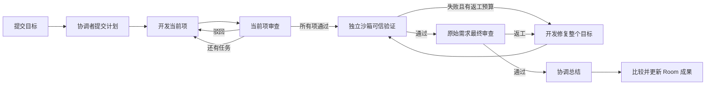

# 候选 Diff 与可信验证

本阶段在串行三角色交付中增加两个可检查的事实：开发实际改了哪些文件，以及平台是否在该不可变候选上运行并通过了预先配置的检查。模型审查仍负责判断需求和实现；完成状态同时受平台检查约束。

## 执行顺序和唯一执行账本



可信验证使用 `camp_operations` 保存系统工作，并在统一的 `camp_runs` 中执行。`executor=agent` 必须绑定真实 task、role、agent；`executor=verification` 必须绑定 operation，task、role、agent 全部为空。数据库约束保证两种身份互斥。验证不会冒充第四个模型角色，也不会创建另一套领取、租约、持久日志或恢复循环。

同一个 Worker 领取接口根据目标冻结的协议和能力分配工作。验证计入目标原有运行次数与总时间预算，失败后的全目标返工还有单独的有界计数。取消、超时、失联和物理资源清理使用已有执行生命周期；只有实际回收资源后才确认清理。

## 管理员配置，目标冻结

有该频道访问权限的服务器所有者或管理员，通过 `PUT /api/camp/rooms/:id/verification-policy` 配置：

```json
{
  "policy": {
    "id": "project-checks",
    "revision": 1,
    "name": "Project validation",
    "maxRepairAttempts": 1,
    "checks": [
      { "id": "tests", "label": "Node tests", "argv": ["node", "--test"], "timeoutMs": 60000 }
    ]
  }
}
```

命令为有界 argv；策略没有额外环境变量、宿主挂载路径或镜像覆盖字段。argv 中的路径在检查容器内解释，需要 shell 的管理员可以显式配置 `/bin/sh -c ...`。策略最多五项检查，每项不超过两分钟，返工次数范围为零至三。服务端规范化策略并计算 SHA-256；新目标及其验证 operation 各自冻结策略和摘要，之后更改 Room 配置只影响新目标。没有策略时不能启动新的 v2 串行交付。

新串行目标使用协议 2；旧 v1 与 legacy 目标保留原约定，不静默改变历史语义。当前 Worker 0.5.0 支持协议 1/2/3（本阶段历史验收使用 0.3.0）。默认逐项目标仍使用协议 2；协议 3 的双候选模式见 [可信集成](./trusted-integration.md)。v2 开发要求 `candidate-diff.v1`，验证要求 `layerfs.candidate.v1`、`candidate-diff.v1`、`trusted-verification.v1`，无需 DSH 或模型密钥。验证专用 Worker 可以只声明自己能执行的工作。

## 固定外部检查

`node --test` 执行候选仓库里的测试，这能提供实际退出结果，但测试本身仍可能被开发修改。要固定关键验收约定，可以在策略中指定：

```json
{
  "id": "contract",
  "label": "Operator contract",
  "argv": ["node", "/camp-checks/catalog-contract"],
  "timeoutMs": 30000,
  "harness": { "id": "catalog-contract", "sha256": "<64 lowercase hex characters>" }
}
```

Worker 的 `CAMP_VERIFICATION_HARNESSES` 指向本地忽略文件，其中保存 `[{"id":"catalog-contract","path":"/absolute/path/to/check.mjs"}]`。Worker 以不跟随符号链接的方式读取普通文件，计算内容摘要后声明能力；不匹配时在分配前拒绝。执行时只挂载可信私有副本到固定只读路径。模型、HTTP 策略和候选都不能替换这个文件；配置管理员仍属于可信运维边界。

## 验证容器与回执

可信 Worker 从 LayerFS 导出冻结候选，运行每项检查时都创建新的普通 Docker 容器，并从同一私有快照重新复制文件。上一项检查修改文件、启动后台进程或删除测试，不会影响下一项检查的起点。

容器使用固定候选镜像、普通 UID、只读根文件系统、无网络、资源限制和临时工作区，不持有 LayerFS Store、FUSE、Docker socket、DSH home、Room 凭据或模型密钥。执行保留普通文件权限；不为了通过检查自动“修复”不可读文件。检查不自动安装依赖，所需运行时和依赖必须已经存在于固定镜像或候选中。

超时需要终止并确认删除整个容器，不能只结束 Docker 客户端。导出容器和检查容器使用原 Run 的所有权前缀，恢复时可据此回收。正常结束和重启恢复在确认容器消失后，按原 Run 的白名单清理私有物化快照及固定检查副本，逐层拒绝符号链接路径；清理辅助容器不会误删仍在使用的父执行快照。Intent、结果回执、journal 和未知文件保留供审计，尚无统一的保留期限；清理确认不等同于删除所有本地诊断文件或回收 Store 历史版本。

Worker 上报每项的 argv、退出码、信号、超时、OOM、耗时以及有界 stdout/stderr。它不上报一个由模型填写的 PASS。服务端核对完整有序检查集、候选、镜像、策略摘要与目标轮次，再生成包含 run/operation 身份和服务端时间的不可变回执。输出截断会明确标记，并使检查不能被当作完整通过。

进入最终审查、完成最终审查、更新 Room head 三处都要求最新匹配验证通过；旧候选的 PASS、旧策略的 PASS、前一轮的 PASS、较早的 PASS 都不能覆盖当前失败。Completion 重放使用原始事实匹配，不重新生成时间、重复增加预算或重复排入返工。

## 文件历史与 Diff

每次 v2 开发完成保存从目标冻结基线到本次候选的累计 changeSet。文件内容、类型、普通 POSIX 权限、符号链接目标及 SHA-256 都来自不可变版本。初始导入可能只有 Layer，修改后才产生 Commit。当前 LayerFS SDK 的聚合 Commit Diff 不接受 Layer 基线，因此这里由可信 Worker 物化两个冻结版本后比较文件系统，兼容 Layer→Commit 和 Commit→Commit。

比较不执行仓库代码，不跟随候选符号链接。目录权限变化、文件增加/删除/类型变化、二进制文件及不适合展示的文本都有明确类型。文本补丁、条目数和总载荷有上限；截断与不可预览原因会显示，不能把不完整列表表示成完整结果。所有路径和日志作为文本渲染。

当前每份物化快照上限为 512 MiB、20,000 个条目，文件名要求合法 UTF-8；不支持特殊文件或 setuid/setgid 权限。报告最多保留 500 个变化条目，单文件补丁最多 16 KiB、全部补丁最多 256 KiB、报告总载荷最多 512 KiB。重命名表现为删除与新增，不提供逐行归因、ACL、扩展属性或文件所有者历史。

历史接口按 Room、Goal、实际生产 Run 授权，不接受任意 Store ref 或宿主路径：

| 接口 | 结果 |
| --- | --- |
| `GET /rooms/:roomId/goals/:goalId/versions` | 冻结基线和开发候选历史 |
| `GET .../versions/:runId/changes` | 本次候选相对基线的持久 Diff |
| `GET .../versions/:runId/verification` | 该候选匹配策略的验证状态和回执 |

以上路径以 `/api/camp` 为前缀。旧版本没有保存 Diff 时明确返回不可用；不会依赖当前 Worker 在线补算历史。公开导出仍执行更严格的目标路径和符号链接限制；内部可以安全比较不跟随的绝对符号链接，不代表此类候选可导出到任意主机目录。

## 验收与边界

真实流程验收：

```sh
node scripts/mvp/delivery-real-smoke.mjs --real
```

该脚本使用本机开发账号和上阶段已导出的 catalog，创建独立频道、项目与 runtime home。首轮刻意延后交付文档，项目测试可以通过但固定外部验收必须失败；系统自动修复后重新验证、最终审查、总结并接受成果。脚本检查两次系统执行、失败前 head 不变、零人工回答/重试、Layer 基线 Diff、历史失败与通过回执、浏览器展示，以及导出后普通隔离容器的独立测试。会使用真实模型额度，不属于默认单元测试。以上是脚本的验收目标，只有本轮成功生成的最终回执才能作为完成证据；上阶段回执不能替代本轮验证。

回执写入 Git 忽略的 `.camp/delivery-latest.json`，凭据另存权限为 600 的 worker.env，不进入回执。无模型回归覆盖协议解析、鉴权、API 状态机夹具、超时、恢复和 UI；真实 PostgreSQL 并发、Docker/LayerFS 隔离与真实模型执行分别保留实测证据。`node scripts/mvp/delivery-ui-smoke.mjs` 使用真实登录、频道 HTTP 和浏览器，但明确拦截 Camp 响应，只验证展示交互，不证明真实调度或验证命令已经运行。具体执行结果在完成本机验收后记录。

## 本机实施记录

2026-10-23（Asia/Shanghai）完成本阶段验收，协议包、Runtime 和插件为 0.3.0。

| 验证 | 结果 |
| --- | --- |
| 共享协议 | 14 项通过，含真实 Chromium 执行、策略/报告/Diff 校验与生成声明新鲜度 |
| 服务端 | 19 个文件、105 项通过；含精确候选门禁、最新失败覆盖旧通过、冻结策略、返工上限、权限与 completion 重放 |
| 真实 PostgreSQL | 2 项通过；历史迁移、所有权 XOR、验证并发领取及并发完成、原有锁序与租约回归 |
| Runtime 与插件 | 107 项通过；含无模型/无插件验证、严格 HTTP 完成体、outbox、超时、白名单临时文件回收 |
| Web | 104 项 DOM 通过；真实浏览器夹具验证配置、版本切换、Diff、回执、安全文本与错误恢复 |
| Docker/LayerFS | 真实 Layer→Commit 和无变化 Layer Diff；普通 UID、每项全新快照、权限与不透明链接、固定 harness 摘要、超时、输出限额、实际 OOM 与 SIGKILL 回收通过 |
| 插件安装 | Docker UID 501 安装 0.3.0 两个包，协议 2 描述、12 个共享 Schema 与真实 DSH profile 解析通过 |
| 本机迁移 | 0378 事务应用，原有 8 个 Room、12 个目标、56 个任务、41 次执行、329 条事件、4 个计划、1 个问题全部保留；旧目标协议与执行归属未改变 |

真实模型目标 `ac617171-7ebe-4235-b9e7-9812b8849ffe` 在新 Room `4f0a308b-ce95-41c7-8f06-268882ee6632` 完成。六次成功 DSH 执行与两次系统验证构成交付主链；另一次规划因本地 API 热重启被中断，持久恢复确认旧执行清理后由 epoch 2 继续。总计 9 次运行、411 秒、1 次自动返工、0 次人工回答、0 次人工重试。

首个候选的项目测试退出 0，外部固定检查因缺少 `Result limits` 说明退出 1，未推进 Room head。返工后两项检查均退出 0，最终审查和总结才将 Room revision 推进到 1。两份 Layer→Commit Diff 分别保留四个和五个文件变化，失败与通过回执均可历史查看。导出清单包含冻结策略与精确候选的完整通过回执；导出成果在额外普通隔离容器中通过固定黑盒验收和 37/37 项项目测试，原始源目录未被改写。

最终回执为 `.camp/delivery-latest.json`，目录 `.camp/delivery/camp-delivery-mvjtl5c3/` 保存清单、成果、审计核对、测试日志和真实 API 浏览器截图。Docker 与安装证明位于 `packages/camp-runtime/.local/` 的 `change-set.json`、`trusted-verification.json`、`verification-sigkill-recovery.json` 和 `protocol-packaging.json`。这些本机运行文件均被 Git 忽略，不随源码暂存。测试脚本支持 `--real --resume .camp/delivery-pending.json` 从同一准备记录恢复；读取轮询允许短暂 API 中断，不对创建请求盲目重试。

本阶段支持单主机 Store、同一 Room 内单父串行执行，尚未验证跨主机 Worker 部署。检查通过表示指定命令在确切候选上得到平台记录的结果，不是对任意语义正确性的证明；服务端信任已授权 Worker、宿主机及 Docker 守护进程报告的执行事实，不提供硬件远程证明或可离线验证的签名回执。LayerFS 仍使用本机 Disposable Store；PostgreSQL 记录与 Worker journal 不构成候选文件的跨主机备份或掉电恢复保证。该阶段没有启用并行候选合并、Git 发布或跨主机 Store。后续已完成单机部署和依次构建的双候选可信合并，见 [部署](./single-host-worker.md) 与 [集成](./trusted-integration.md)；有界并发仍需后续验证。
