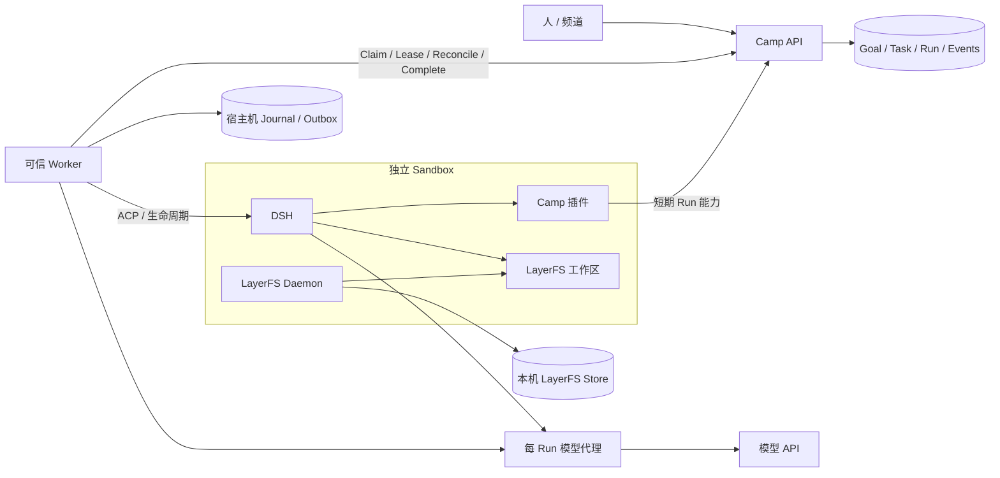

# Camp 长期演进：可靠执行与目标工作流

## 本阶段的交付

把一次演示发展成可以持续运行、故障后可以检查和恢复的工作系统。DSH 继续是唯一新增 Agent 执行入口；Camp 管协作事实与调度，可信 Worker 管执行生命周期，LayerFS 管文件版本。

本阶段实现目标分组、预算、恢复日志、可靠结算、遗留 Sandbox 回收和可观察的人工重试。动态拆分及并行候选合并的下一阶段设计见 [工作流与合并设计](./durable-workflows-next.md)。两阶段依赖关系明确：恢复与版本身份稳定后，才能扩大并发。

未来跨主机执行时，Worker 到 Sandbox 的生命周期协议可以换成远程执行适配器；DSH 的 ACP 和 Camp 插件契约保持一致。基础设施控制权、Room 长期凭据与模型真实凭据仍属于可信控制侧。

## 状态及责任

| 对象 | 持久位置 | 责任 |
| --- | --- | --- |
| Goal 与人工 Attempt | PostgreSQL | 目标、预算、当前状态及需要介入的原因 |
| Task 与依赖 | PostgreSQL | 可领取工作，关联 Goal Attempt，保留历史 |
| Run / epoch / lease | PostgreSQL | 当前执行权；控制侧时钟决定有效性 |
| Claim intent | Worker 私有日志 | POST 响应丢失时重用原请求身份 |
| Sandbox 与 LayerFS candidate | 本机 Docker / Store | 每个 Run 的独立执行及文件版本 |
| Completion outbox | Worker 私有日志 | 保存待补交的完整语义结果 |
| 频道与界面 | PostgreSQL 事件的投影 | 显示进度、预算、恢复和结果，不创造执行事实 |

一个 Goal 包含多个人工 Attempt；每次显式重试形成新一代，旧 Task、Run、事件及候选全部保留。自动失败恢复和复审仍属于同一人工 Attempt，消耗同一预算。并发重试使用 `expectedAttempt` 比较，不能因为双击或丢失响应而创建两代。

预算上限由服务端检查。运行次数、复审轮次和总时长耗尽时进入 `needs_attention`，停止自动追加任务，并给出明确原因。界面显示消耗和剩余量；用户重试是显式操作，后台不自行重置预算。

## Claim 的可重放性

Worker 在发请求前持久化 `claimId`。它以 Room Worker 凭据和该 ID 派生 Run 能力令牌，服务端只存能力令牌的哈希。相同 `workerId + claimId + token hash` 对应同一次分配。

如果服务端已经分配任务、响应却丢失，重试返回原 Run，不能再次分配其他任务或轮换 Run Token。不同 Worker、不同能力令牌或已失效的分配不会重新授予旧执行权。长期 Room 凭据和真实模型凭据不写入日志、模型上下文或 Sandbox。

Worker 身份在进程重启间稳定。Linux 进程锁防止同一身份被本机两个进程同时使用；多 Worker 需显式使用不同身份。锁解决的是当前主机上的身份复用，跨主机身份管理属于后续分布式部署工作。

## 执行与结果结算

1. 保存 Claim intent，再发起 Claim。
2. 保存已获分配的 Run 身份及 epoch，再创建 Sandbox。
3. 保存准备阶段信息和独占容器前缀；创建过程中失败也能定位资源。
4. Worker 持续续租，DSH 只持短期 Run 能力与模型代理能力。
5. DSH 完成后保存会话、LayerFS 候选及完整不可变 Completion payload，进入 `result_staged`。
6. 清理该 Run 的执行资源，持久记录清理事实，再提交 outbox。清理中途崩溃时仍保留已完成结果。
7. 服务端确认后把 outbox 标为已结算；重放不能重复发消息、完成任务或追加复审。

日志文件通过临时文件、文件同步、原子重命名和目录同步持久化，放在可信宿主机、Store 之外。文件和目录权限限制其他用户访问。日志损坏或持久化失败必须停止接新工作，不能把日志错误当作“没有待恢复记录”。

Completion 只重放原始语义结果。网络错误与可重试的服务故障使用有界退避；鉴权错误、权限拒绝和旧 epoch 拒绝不被当作暂态错误。重启时先处理 outbox，再领取新任务。未获得明确确认的候选及拒绝原因保留用于检查。

**过期租约没有补交后门。** 尚未结算且已经过期或被替代的 Run，不能因日志中存在成功结果而覆盖新 Run。已经成功结算的同一结果可以得到幂等确认。系统保证服务端结算副作用不重复，不声称模型调用、外部网络操作或所有工具副作用 exactly-once。

## 恢复与资源回收

服务端周期性检查租约、取消和目标预算。它不依赖恰好有 Worker 来领取下一项任务才更新状态。跨副本使用数据库锁，避免两个检查器对同一 Room 重复推进状态。

Worker 启动后核对本地日志与服务端 Run 状态，只处理自己登记的 Run 和独占容器前缀：

| 服务端事实 | 本地处理 |
| --- | --- |
| 完成且有待确认 outbox | 重放原结果并核对幂等确认 |
| 租约过期、Run 结束或已被替代 | 清理旧 Run 的执行资源，保留诊断与候选 |
| 其他 Worker 的有效 Run | 保留，不接管、不终止 |
| 无法访问控制侧 | 不推断为过期；暂停新执行并退避重连 |
| 权限撤销或凭据失效 | 停止新工作；不得自动扩权或更换凭据 |
| 本地元数据损坏或身份不符 | 显示恢复阻塞，要求检查 |

Worker SIGKILL 后模型代理会随宿主进程消失，但容器和工具子进程可能仍存在。回收必须显式检查并停止资源。控制侧 API fencing 与物理资源终止是两件事，界面区分“取消请求”“已清理”和“清理未确认”。

对已过期 Run 的清理确认使用独立、幂等的 `/worker/runs/:runId/cleanup` 接口，只记录物理资源回收，不修改原结果或延长租约。已经保存成功结果后又收到取消时，使用独立的取消确认 outbox；原成功 payload 不被改写成另一种结果。

同一主机的 Worker 共享 `CAMP_RUNTIME_HOME`。项目首次导入使用按 Docker host 和 project ID 命名的进程锁；已经存在 Store、但缺失本地项目身份记录时拒绝重新导入，避免覆盖另一个部署的文件状态。

## 审查与版本身份

审查绑定控制侧提供的可信 Builder candidate，不接受模型自行填写的任意 Commit。`camp_review` 从当前上下文读取目标，把结论和证据关联到该版本；服务端验证身份和版本匹配。

自动批准必须针对被检查的文件状态。如果审查执行修改了工作区，不应把原候选的批准结论套到新文件版本上。复审产生的诊断快照与 Builder 候选分开表达，后续开发从明确指定的候选继续。

## 验证矩阵

| 场景 | 必须看到的结果 |
| --- | --- |
| Claim 已落库但响应丢失 | 原 Claim/Run 重放；无第二次分配 |
| Worker 执行中 SIGKILL | 租约周期检查推进状态；恢复后只清理旧执行的 Sandbox |
| Completion 已落库但响应丢失，随后 Worker SIGKILL | 重启从 outbox 确认成功；无重复消息、后继或模型执行 |
| 旧 Run 结算与替代 Run 并发 | 旧 epoch 拒绝；新结果不被覆盖 |
| 控制侧短暂不可用 | 不丢日志、不误杀他人有效 Run；恢复后继续核对 |
| 两个进程复用同一 Worker 身份 | 第二个无法启动执行循环 |
| 连续 changes_requested | 达上限进入 needs_attention，不无限追加付费执行 |
| Goal retry 双击/重放 | 只有一代新 Attempt，历史仍可查看 |
| Goal cancel 与完成并发 | 有一致的终态；后继不能在取消后悄悄启动 |
| 审查伪造/换候选 | 服务端拒绝，无有效批准 |
| 跨 Room 或撤销后的凭据 | 无权读取恢复记录或操纵执行 |

默认测试使用真实应用、PGlite、隔离 PostgreSQL、模拟 ACP 与可控网络故障，不需要模型密钥。显式真实测试使用本地 DSH、Docker、LayerFS 与用户配置的模型；报告区分测试替身与实际组件。

## 后续阶段

1. **本阶段：可靠目标工作流。** 完成并验证恢复、预算、目标交互和版本绑定。
2. **结构化规划与并行执行。** 引入受约束 DAG、多 Worker、角色收件箱；先完成并行候选的可信合并及冲突路径。
3. **可信整合。** 独立测试任务、候选 Diff、基线变化检查、明确的发布权限与幂等发布协议。
4. **部署与隔离。** 固定可分发镜像、资源和网络策略、独立制品导出、存储恢复与多主机执行适配。
5. **开源产品体验。** 自助演示、可复现故障实验、架构说明与贡献边界，让用户能理解团队行为和验证结果。

## 实施与验证记录

2026-10-22 已完成本阶段实现。新增 `0375_camp_goals.sql` 已先在独立 PostgreSQL 验证旧数据迁移，再单独以事务应用到现有开发库；未重置数据库或修改 `0374`。

| 检查 | 命令 / 证据 | 实际结果 |
| --- | --- | --- |
| Runtime 回归 | `node --test packages/camp-runtime/scripts/*.test.mjs` | 36 项通过；含 Claim 重放、原子日志、结果/取消 outbox、过期 fencing、模型请求预算、超时、停机 drain 和进度队列 |
| 服务端 API 与路由 | `pnpm --filter @botiverse/raft-server exec vitest run src/routes/camp.goals.test.ts src/routes/camp.test.ts src/test/routeAuthorityClassification.structure.test.ts` | 13 项通过；包含预算、真实 canonical blocked、重试 CAS、旧预算历史、依赖保留、撤权、版本绑定及清理确认 |
| 真实 PostgreSQL | `CAMP_REAL_PG_REQUIRED=1` 与私下配置的 `CAMP_REAL_PG_URL`，运行 `src/services/camp/camp.realPg.test.ts` | 2 项通过；隔离临时库验证并发 Claim/重放/epoch/retry/reconcile 锁与旧数据回填，结束删除该临时库 |
| Web 回归 | Goal DOM 与原 composer DOM | 71 项通过，另有 3 项命令解析测试；类型检查、目标 lint、i18n 检查通过 |
| DSH 插件 | `node --test packages/dsh-plugin/test/*.test.mjs` | 7 项通过；审查绑定服务端候选，授权丢失不重放；插件类型检查通过 |
| 真实进程崩溃回收 | `node packages/camp-runtime/scripts/verify-worker-recovery.mjs` | 真实 Docker/LayerFS 中 SIGKILL 后旧容器存在；恢复删除旧容器，并保留另一个有效 Worker 的容器；`.local/worker-sigkill-recovery.json` |
| 真实并发初始化 | `node packages/camp-runtime/scripts/verify-project-init.mjs` | 两个并发准备只初始化一次；不同 home 拒绝覆盖已有 Store；`.local/project-init-concurrency.json` |
| 真实模型故障链路 | `node scripts/mvp/recovery-smoke.mjs` | Claim 响应丢失、执行中 SIGKILL、3 次临时 503、完成落库后丢响应并 SIGKILL、两次重启全部通过；只有 epoch 1 和 2 两个 Run，最终一次幂等确认，无第三次模型执行 |
| 真实三角色流程 | 浏览器 `/camp` + 官方 DSH + baked image + LayerFS | 新 Goal 完成规划、修复和独立 `approved`；Builder/Reviewer Commit 同为 `12e4884b7d08a2a29e9f4bb9a82c3965a51c2b5b01331aab1f3e87e0bab2d8cb88`；`.camp/durable-latest-state.json` |
| 真实浏览器 Goal 交互 | `node scripts/mvp/goal-ui-smoke.mjs` | 运行上限阻止后继，重试保留两代共 6 个 Task 与旧预算原因，取消新一代成功；协议夹具，0 次模型调用/0 个 Sandbox；`.camp/goal-ui-latest.json` |

模型故障实验结果在 `.camp/recovery-latest.json`；对应浏览器和 Worker 日志均位于忽略目录。常驻 Worker 已用本阶段配置连接新的演示 Room。

剩余边界：当前只支持单一 Linux host 和本地共享 runtime home；LayerFS 使用 Disposable Store，这些结果证明进程故障恢复，不证明掉电后的文件系统耐久性。Worker 长期离线时没有独立 host reaper；未知 SDK 结果保留 `requiresInspection`，需要检查后恢复。中断的模型回合不做活进程恢复；完整结果保存前可能需要新的有界执行。请求数和字节预算不是货币成本硬上限，CPU/内存/磁盘/网络硬配额仍待部署阶段实现。动态 DAG、可信合并及自动发布尚未启用。
