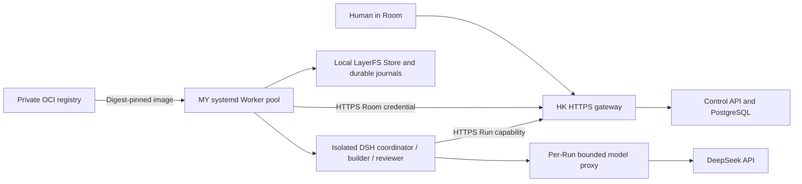

# Persistent HTTPS control and remote DSH execution

The control API owns scheduling and authorization. A trusted host Worker owns
one Room's writable Store and local Docker pool. DSH roles receive only Run
capabilities and a bounded, ephemeral model proxy token. HTTPS, systemd and OCI
distribution preserve these boundaries; they do not introduce another scheduler.



## Stable endpoint and trust

Use one stable HTTPS origin before creating the production runtime home.
Origin spelling is part of journal and pool identity. Moving from an SSH
loopback address to HTTPS requires a new deployment identity or an explicit
storage handoff; changing an existing env file is not a transparent migration.

The initial internal deployment uses `https://8.217.75.234` with an IP SAN and
an operator private CA. Public DNS is not required. The HK ingress permits 443
from MY and existing trusted operator addresses; it does not expose the backend
API port. Install the public root on every client that accesses this origin.
Never bypass certificate checks. Verify the root fingerprint through the
known-host-verified provisioning connection before adding it to trust.

`scripts/deploy/control-plane.mjs` renders nginx and certificate service/timer
configuration. Use a private JSON file with public deployment metadata:

```json
{
  "publicIp": "8.217.75.234",
  "apiPort": 13018,
  "webPort": 15190,
  "webRoot": "/srv/camp/web/REVIEWED_RELEASE",
  "pkiDir": "/etc/camp/pki",
  "rootCaDir": "/private/offline-root",
  "scriptPath": "/opt/camp-control/control-plane.mjs",
  "nodePath": "/opt/node/bin/node",
  "configPath": "/etc/camp/control.json"
}
```

`webRoot` serves a built same-origin frontend; without it the renderer proxies
the separately supervised web listener. `rootCaDir` prevents the online issuer
unit from accessing the offline signing key. No Worker receives a signing key.
Rendering is read-only; install reviewed files and nginx explicitly. The
renderer does not silently replace an existing deployment.

```sh
node scripts/deploy/control-plane.mjs init --config /etc/camp/control.json \
  --root-ca-dir /private/offline-root
node scripts/deploy/control-plane.mjs render --config /etc/camp/control.json
node scripts/deploy/control-plane.mjs renew --config /etc/camp/control.json
```

Initialization exclusively reserves a fresh PKI and never replaces an existing
or partial one. Root certificates last ten years, the online constrained
intermediate two years and serving leaves 90 days. A daily timer renews leaves
with at most 30 days remaining, retaining the serving key and atomically
publishing a verified chain. Initialization and renewal serialize through an
OS lock. Expired/short-lived issuers, mismatching keys and invalid chains require
inspection. Operators must replace the intermediate before its remaining life
falls below a leaf's full lifetime and retain a safe copy of the offline root.
The initial offline directory is root-only on HK; moving it to offline storage
remains an operator custody task. Daily renewal does not extend issuer lifetime.
The renewal unit hides that path when present and tolerates its absence after
offline removal. PKI directories and public trust-anchor files require trusted,
non-writable parent directories; a root-owned sticky `/tmp` is permitted for
isolated tests. PEM inputs must be ASCII certificate bytes only. Before skipping
a healthy-looking leaf, renewal verifies its full issuer chain, IP identity and
server purpose, including CA path-length constraints. OpenSSL invocations have
a fixed deadline and expose no private-key command output.

Process-crash tests kill renewal immediately before and after the atomic chain
rename: the complete previous or replacement chain remains readable, the serving
key is retained, and the kernel issuer lock is released. These tests cover
process loss, not a storage power-loss durability claim. Interrupted initial
publication remains an explicit partial PKI requiring inspection; initialization
does not replace it.

Nginx preserves socket upgrades and streaming responses. Private artifact parts
are bounded at 8 MiB; a 10 MiB gateway request limit leaves envelope headroom.
Request/response buffering and access logs are disabled for this gateway so
private transfer payloads are not spooled into proxy temporary files. API bearer
authorization remains required. Private CA trust is server authentication, not
a replacement for Room/Run access checks or an internet-facing account policy.

The Worker host uses `NODE_EXTRA_CA_CERTS`. `CAMP_CONTROL_CA_FILE` installs the
same **public** self-signed root in each actual role container, updates its OS
trust store and supplies Node's extra trust path to DSH. This deployment trust
does not rebuild the fixed image or change a candidate's image identity.

## Supervised control and Worker

The [control API renderer](../../scripts/deploy/README.md) produces a foreground
systemd service using the reviewed checkout and existing server dependencies.
It runs without a filesystem watcher and binds to `127.0.0.1`. Preserve database,
session and capability secrets when transitioning the previous API owner. Give
the database, Redis, object store and RisingWave their own persistent restart
policies and retained volumes. Only one API owner may bind the local port.
This deployment is a supervised internal control service; the API still uses
the existing full checkout and installed dependencies, unlike the standalone
Worker release. Upgrades require an explicit reviewed checkout and restart.

The [Worker service installer](../../scripts/deploy/worker-service.md) validates
the complete immutable release before executing it, exact toolchain/image,
private credential and model files, and the fixed Room/Worker/storage home.
It installs a stopped service; enabling and starting are separate explicit
operations. Production state, immutable release, immutable toolchain and
operation evidence live in separate directories.

The trusted Worker currently runs as root to access local Docker and native
volume paths. DSH processes run as UID 501 inside limited containers. One host
manager per Docker daemon and Unix UID serializes pool ownership; retain its
shared lock namespace (`PrivateTmp=no`). Never run a second manual manager
alongside the service. Ordinary unsafe exits remain failed for inspection;
abnormal process loss restarts through journal recovery. A systemd restart is
not evidence that live-Run power-loss recovery has been tested.

## Renewable Room credential

Store the complete administrator-issued credential response in a root-owned
0600 JSON file under a 0700 parent. Units contain its path, never the secret.
`CAMP_WORKER_ROOM_ID` fixes the intended Room. Before any recovery or claim,
the Worker calls authenticated `POST /api/camp/worker/credential/renew` and
matches the server's tokenId/roomId with the deployment metadata. Swapping a
bearer into edited local JSON cannot rebind the Store.

Each credential has a seven-day lease and a 90-day absolute renewal limit.
Active heartbeats and idle polling share singleflight renewal once a day using
a monotonic clock, including when the remaining lease is capped by the deadline.
Elapsed wall time also triggers renewal after a suspended host resumes.
Renewal keeps the same secret/tokenId, rechecks the Room/token locks and
publishes metadata with file and directory fsync before ordinary API requests
continue. Every process start authenticates again, and a lost response is safely
retried even if local expiry metadata is stale; the server decides whether the
credential remains valid. Credential reads reject FIFO files and writable parent
directories before startup. The standalone doctor, storage, private-artifact and
Goal export CLIs use the same managed-file authentication and renewal boundary;
offline exports and local recovery remain independent of API availability.
Revoked or expired credentials cannot renew. Renewals cannot outlive the
90-day deadline, issue alternate tokens or grant Run tokens Worker authority.

An administrator must reissue credentials before that deadline, or after more
than seven days offline. Drain and inspect pending claims/outboxes before
replacing a secret: their Run capability recovery is HMAC-bound to it. Keep
the old file privately while recovering an ambiguous allocation. Never delete
journals to make credential replacement appear successful.

## Image distribution and actual model acceptance

Follow [private OCI distribution](private-oci.md). HK publishes the fixed image;
MY authenticates to the public ACR endpoint and pulls a full digest. Record
registry digest and local image ID separately and validate both. Registry and
model credentials are private host configuration; neither enters the image,
source project, Room chat or standalone release.

The three-stage real acceptance harness is independent of the synthetic
two-host cold handoff:

```sh
node scripts/mvp/remote-model-smoke.mjs prepare
# Install/start the reviewed persistent Worker for the returned Room.
node scripts/mvp/remote-model-smoke.mjs submit --real-model --context /private/context.json
node scripts/mvp/remote-model-smoke.mjs verify --context /private/context.json
```

Preparation creates an independent Room and a project on MY with three modules,
six tests and a fixed external inventory/hash/behavior harness. The constant
service performs actual DSH coordination, three-node dependency execution,
automatic review, trusted integration and independent verification. The probe
does not inject role decisions or create another manager. Evidence includes
API Run/session/candidate facts, real proxy request counters from journal,
private control reachability, protected files and original Room preservation.
Success leaves the service, credential and Room active for further work.
The external behavior probe imports candidate modules only in a bounded child
process. Its parent validates the complete observation report and file inventory
before printing success; candidate output or an early zero exit alone cannot
pass. This does not provide isolation from arbitrary malicious code running
under the same container UID.

Keep private deployment receipts under ignored `.camp/production` and real model
receipts under `.camp/remote-model`; publish only the non-secret conclusions.
The writable authority remains one Room Store on MY. This does not add
concurrent multi-host writers, arbitrary graphs, an unprivileged host sandbox,
an OCI cold-download claim or a live-Run power-loss acceptance.

## Executed acceptance: 2026-10-23

The initial real-model acceptance used Worker source commit
`fb670a98a7795ffbe9c22921e586d32b57173d17`, manifest
`ade666303c2eb3d7f948a1ade8dfb754fb5aa8aa81060d7eab8f0008fd507ffb`.
HK runs enabled `camp-control-api.service`, nginx and the certificate timer.
MY runs enabled `camp-worker-my-verified.service` for Room
`a392707d-8817-45b7-8dae-243752294506`, with its state and checks under
`/data/github-projects/rcyw/camp/operations/model/remote-model-fdb5b175-118a-44cf-8d29-b7de51769a78`.
Its operator configuration is `/etc/camp/worker-verified-service.json`.

The clean model Goal `f75b50e3-6f14-4540-acfa-bb5682a4057d` completed in
248 seconds: nine real DSH role Runs, two system Runs, three approved tasks,
native v2 integration, all six project tests and the frozen external check.
All sessions and cleanup were confirmed; there were no human answers,
manual retries, reworks or mid-run operator interventions. The private journal
recorded 69 model proxy request attempts, not a provider token/billing count.
The accepted head advanced once, and the original demo's nine Runs/head/storage
remained unchanged. The passing receipt is `.camp/remote-model-latest.json`.

After completion and a confirmed idle Room, a single SIGKILL to the MY main
Worker triggered systemd's abnormal-exit recovery. A new PID recovered both
lanes with the same pool, storage, all eleven settled journal completion
digests, API Run/session/candidate facts and accepted head. An explicit HK API
restart then restored verified MY HTTPS access with the same results. Both
services remain enabled and active. The receipt is
`.camp/production/persistent-service-recovery.json`. No machine reboot or
active-Run crash/power-loss recovery was claimed.

## Deployment review: 2026-10-23

The reviewed Runtime is published as a separate 65-file release from
`defa1e4d6f8f4616e0e5ea7ac777c522f12ce6db`, manifest
`5b16e54fcf4e66d0ff961475c83d596f91cb2c28b4029814398b825340413fcf`.
The installer upgrades the existing service to a resumable schema-2 installation
with a pinned environment generation, preserving its Room, credential path,
runtime home, pool, Store and settled journals.

The review includes 603 passing automated tests: 321 Runtime, 51 deployment,
62 end-to-end tool, 49 protocol/plugin and 120 server tests, including real
PostgreSQL checks. Server type checking and scoped lint also pass. Regression
cases cover interrupted installation and certificate publication, competing
installers, loaded systemd overrides, public bind overrides, capped credential
renewal, suspended-clock recovery, invalid credential/CA files, OCI daemon/TLS
policy, wrong published image identity and forged behavior-probe completion.

MY independently pulls and checks the existing private OCI digest with the
reviewed helper. HK renews its leaf and reloads nginx while retaining the public
root, online issuer and serving key; verified MY HTTPS access succeeds.

The already accepted candidate is exported by exact immutable identity and
rechecked in two isolated containers: all six provided tests and the strengthened
external contract pass. The export, original contract, journals, pool and project
metadata remain unchanged. Room policy revision 2 selects a separate,
content-addressed external harness for future Goals. The completed model Goal
retains its original frozen policy and original model-execution evidence.
This review submits no new paid model Goal.

Private review receipts live under `.camp/review-https`, including the OCI pull,
certificate comparison, accepted-candidate recheck and policy update. Retain the
original model context/receipt as historical execution evidence; a post-upgrade
context describes the current service release separately. Submission and
verification reject a live release/service that differs from the reviewed local
context.

After this upgrade, an idle SIGKILL again recovers both MY lanes with the same
pool, storage and all eleven settled completion records. HK API restart restores
MY HTTPS access; both lane timestamps advance after the restart intent. The API
listener remains `127.0.0.1:13018`. Both services remain enabled and active, and
the original demo retains its nine Runs and accepted head. The updated recovery
receipt is `.camp/production/persistent-service-recovery.json`.

A preliminary model trial exposed a production staging bug: `writeFile` mode
`0444` was masked to root-only `0400` by the private service umask. The fixed
runtime now writes the verified copy through an exclusive FD, explicitly
chmods to `0444` and fsyncs before the read-only mount, retaining its private
host parent and the source's permissions. An actual UID 501 Docker test proves
the fixed copy is readable and the old copy fails. The failed preliminary Goal
and evidence were retained separately; its service is disabled and its credential
revoked. It was never reported as a passing model acceptance.

Validation passed: 315 Runtime checks including the real Docker permission case,
120 server/API and PostgreSQL checks, 90 deployment/smoke checks and 49 protocol
and plugin checks. TypeScript, lint, static frontend builds, secret scans and
real HTTPS certificate renewal also passed. Receipts contain no provider,
Docker-login or Room bearer secrets.
