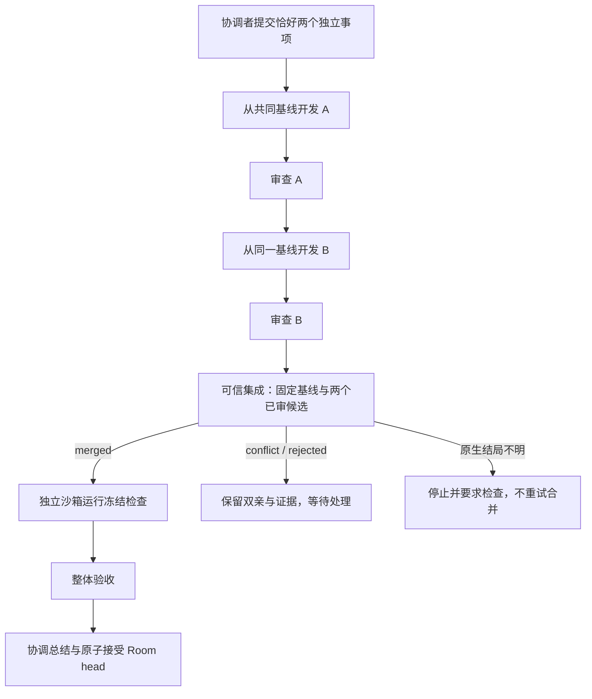

# 同基线双候选可信集成

本阶段提供一种显式的 `same_baseline_pair` 目标：协调者拆成恰好两个独立事项，两个开发执行分别从同一不可变基线出发，各自审查通过后由可信 Worker 集成，再独立验证、整体验收和总结。两个开发执行目前依次领取，不开放任意 DAG 或并发。普通 `sequential` 目标仍逐项继承前一项结果。

## 产品与兼容接口

Room 快照的 `supportedPlanModes` 广告可用模式，旧服务没有该字段时界面只提供逐项模式。提交沿用 `POST /api/camp/rooms/:roomId/tasks`，可增加 `planMode: "same_baseline_pair"`。模式在 Goal 创建时固定，人工重试不能替换模式、基线或检查策略。

本记录对应 Worker、插件和共享包 0.5.0，支持执行协议 1/2/3。当前 0.6.0 双事项并行和协议 4 另见 [有界并行执行](./bounded-pair-execution.md)。普通新串行目标继续冻结协议 2，依次执行的双候选目标固定协议 3；旧目标及其原始 outbox 保持原契约。领取前检查协议、任务与能力，只有协议 2 的 Worker 对双候选目标零分配、零预算。新 Worker 连接旧 v1/v2 服务时缩减实际声明。模型插件仅声明六类模型任务，不声明系统验证或可信集成权限。

流程如下：



每项审查驳回仍可有界返工。整体验收或验证失败后的修复沿集成候选执行，不重组或覆盖原双亲回执。检查、审查和接受绑定最终修复后的精确版本，不能复用其父候选的通过结论。这个模式适合文件边界清楚的独立事项；需要前一项代码的任务应继续使用逐项模式。

## 控制侧事实与数据模型

- `camp_goals.plan_mode` 默认 `sequential`；`reviewed_items` 保存当前 attempt 的事项 key、生产 Run/epoch、候选和审查 Run。
- 审查的生产者从规范任务依赖定位，要求唯一、已完成、同 Goal/attempt/事项且候选身份一致，不能按完成时间任选一个版本。
- 第二项通过后，控制侧按计划顺序固定恰好两个生产者，创建唯一的 integration operation。`camp_operations.kind` 区分验证与集成，两个分支各有自己的持久载荷。
- 集成使用同一 Run 账本与租约：`executor/taskKind = integration`，无模型角色、规范任务、Agent ID 或 Run 凭据。它计入总运行次数和截止时间，不消耗模型调用预算。
- 新增迁移 0381 和独立检查标记迁移 0382；历史目标保持 sequential，既有执行字段和验证回执不改写。0382 只根据已有同 attempt 的明确未知结果回填检查标记。

集成输入使用无运行环境依赖的协议包的严格校验和稳定序列化：

```json
{
  "schemaVersion": 1,
  "algorithm": "layerfs-three-way-v1",
  "policy": "reject-overlap-v1",
  "base": { "...": "完整不可变候选" },
  "parents": [
    { "key": "a", "runId": "生产 Run UUID", "epoch": 1, "candidate": { "...": "候选 A" } },
    { "key": "b", "runId": "生产 Run UUID", "epoch": 1, "candidate": { "...": "候选 B" } }
  ]
}
```

`inputDigest = SHA256(serializeIntegrationInput(input))`，覆盖基线、双亲顺序、生产身份、算法和策略。报告固定为 `merged/conflict/rejected`，包括该摘要、精确结果候选或有界冲突路径；不能以模型文字、任一父版本或截断 Diff 替代合并结果。服务端增加 operation/Run 身份和记录时间形成回执。成功时候选必须属于同一项目和镜像，`baseRef` 指向冻结基线，保存基线至集成结果的展示 Diff。

## LayerFS 适配与完整树核对

固定 LayerFS revision 的 `branch.merge` 接受分支名，不能直接接受 Commit ID。因此适配器先验证不可变基线与双亲的 root/project/image，再将精确引用 fork 到本执行私有的可信分支；不会读取可变原分支 head 作为输入。完整快照限制为每份 512 MiB、20000 项（包含根），准入超限在 native 变更前明确拒绝，不作为临时错误重试。first-parent 祖先扫描最多 4096 个 Commit。当前策略只接受可证明从基线出发的单父路径；基线本身可以是已接受的合并 Commit。

`reject-overlap-v1` 的边界有意保守：

1. 比较基线到两侧的完整路径、类型、模式、文件字节 SHA 和符号链接目标，不使用界面截断的 Diff 应用补丁。
2. 任意同路径双侧改动均拒绝，包括两侧写入相同内容；祖先/子路径的跨侧结构修改也拒绝。
3. 任意路径段为 `.lww` 时拒绝，调用 native merge 的 `units` 固定为空。模型不能选择冲突策略或“采用某侧”。
4. native 返回的有序来源、mergeBase、结果分支、冲突、LWW、units 和截断标志全部核对。创建新的输出分支，保留原候选。
5. 将实际合并结果完整物化，与从基线及两组非重叠改动推导的预期树逐项比对。任何遗漏或未批准选择都不能成为可接受版本。

无改动的 Layer 可以继续作为 Layer，不伪造空 Commit。二进制、删除、模式和链接按文件树语义核对；不承诺保留 uid、mtime、inode、硬链接拓扑或进行通用语义合并。即便集成通过，独立验证和最终审查仍必须执行。

## 崩溃、取消与未知结果

Worker 保留 `integration-intent.json`、native 回执、完整树验证摘要与结构化报告。第一次可信 fork 之前记录 mutation intent；原生调用与结果验证之间出现超时、NameTaken 或无法证明的状态时，停止而不换一个名字重试。

恢复区分以下事实：

| 断点 | 动作 |
| --- | --- |
| 尚未开始集成元数据变更 | 清理自身辅助资源，可按原基础设施重试策略重新执行 |
| 完整报告及派生 Diff 已持久保存，outbox 尚未落盘 | 只读核验本机验证事实后重建原完成载荷，不再合并 |
| 原完成 outbox 已存在 | 原样补交；响应丢失不改变摘要或重复接受版本 |
| native 已改变元数据，但没有完整验证事实 | 清理自身物理资源，保留 Store/intent/native 证据，标记 `integration_inspection_required` |
| 失败或取消 outbox 的响应丢失，同时仍需检查 native | 允许同 owner/epoch 的原失败或取消载荷重放与清理确认，随后继续阻止新领取和合并 |

`integrationInspectionRequired` 是独立持久标记，取消、预算停止和清理确认不能清除它。原生结局不明时，同 Goal 的自动重排和人工重试都关闭；当前没有“确认检查后恢复”的产品入口。不要删 outbox、清 Store 或改一个 Worker ID 规避检查。保留证据并由可信操作员检查；未来可加入显式复验和恢复 operation，不通过猜测成功推进。

取消、截止时间与失租继续受原 fence 约束。已经有物理清理事实，不表示 native 合并结果已知；已有候选文件，也不表示 Goal 已获接受。

## 界面与验收

界面显示模式、共同基线、两个按计划排序的生产者、集成策略/摘要、系统操作、冲突、旧 attempt 证据与精确结果。目标停止且尚未分配对应验证操作时，服务端投影为 `not_run`，界面显示未分配检查；已有操作保留其实际执行状态。版本历史包含基线、A/B 与集成生产 Run，可查看相应 Diff 和独立验证回执。成果清单包含输入及集成回执；下载、继续需求和 Room head 推进仍以服务端 `resultReady` 为准。

```sh
node --test packages/camp-protocol/test/*.test.mjs
node --test packages/camp-runtime/scripts/*.test.mjs
node packages/camp-runtime/scripts/verify-integration.mjs --real
node scripts/mvp/integration-real-smoke.mjs --real-infra
# 明确的真实 DSH / 模型调用，使用已有 .camp/runtime.env
node scripts/mvp/integration-model-smoke.mjs --real-model
```

独立示例见 [camp-pair](../../examples/camp-pair/README.md)。本机 0.5.0 bundle 与标准镜像另存为 `.local/toolchain-bundle-0.5.0` 和 `.local/integration-image.json`，没有覆盖旧项目镜像。基础设施回执 `.camp/integration-infra-latest.json` 明确标注角色输出为合成，真实模型回执另存 `.camp/integration-model-latest.json`；二者不能混为同一证据。

## 本机实测记录

2026-10-23（Asia/Shanghai）完成本阶段验收：

| 验证 | 结果 |
| --- | --- |
| 共享协议及 DSH 插件 | 35/35 |
| Runtime | 222/222，包含完整树、协议退回、故障、取消、Journal 私有边界与精确补交回归 |
| Web DOM | 8 套、146/146；类型检查、相关 lint 与 i18n 检查通过 |
| Server 与权限 | Camp 80、权限分类 3；真实 Camp PostgreSQL 3/3；类型检查通过。另覆盖普通任务与频道成员/生命周期回归，见 [再次审查记录](./code-review.md#双候选阶段的再次审查2026-10-23) |
| 原生 LayerFS | 二进制、删除、模式、无改动 Layer、含 secondParent 的合并 Commit 作为下一轮基线、输入不变及真实 SIGKILL 全部通过 |
| 完整基础设施 | 4 个独立 Room：正常集成并从 SIGKILL 恢复、冲突拒绝、native-only 未知结果、取消与未知结果竞态；后者取消状态保留且检查标记与重试封锁持续有效 |
| 真实 DSH | 7 次模型执行 + 2 次系统执行，共 9 Run、215 秒；两事项通过，0 人工回答、0 人工重试、0 返工 |
| 成果 | 项目四项测试与固定外部检查通过；完整导出后再次在无网络、只读普通容器核验两组检查 |
| 真实浏览器 | 不拦截 API 回应，核对双亲、集成版本、两处文件 Diff 与相同候选的验证回执；无 Camp 写入或额外模型调用 |

导出保留原文件模式，私有根目录可以为 0700。独立导出验收为了读取该根使用无 capabilities 的 UID 0 容器，仅挂载只读成果和 harness；产品内候选验证仍使用 UID 501 的全新普通沙箱副本。这两项证据分别记录，不将导出验收描述为同一非 root 验证。

新镜像精确 ID 为 `sha256:09686b9d69370224848ccacdfe8ee4a77e964b928dfc58e8c8f6ed653a5772fa`，bundle 摘要为 `e02ceca0133eccbd44622ce90136824783976bd741ce6b69647eba8473bd8675`。它们没有替换原项目镜像或旧 bundle。

本阶段验收时常驻 Worker 连接真实双候选演示 Room，0.5.0 bundle/镜像预检通过。当前入口以 `.camp/active-demo.json` 为准；后续切换到 0.6.0 并行池前的本阶段配置保存在 `.camp/worker.before-parallel.env`，Room、候选与原回执仍保留。迁移 0381/0382 均事务应用，既有执行事实和记录行数保持不变；0382 根据明确既有事实回填了一项检查标记，没有伪造历史迁移台账。

## 后续阶段

先在同一存储主机开放两个事项的有界并发，补齐并发准入、总资源上限、两个执行的取消和失联恢复；沿用本阶段集成门禁。验证后再引入持久依赖边、拓扑校验和多父节点调度。多机 Worker 仍需要独立制品传递、Store 持久恢复和存储归属设计，不能把同内核 Disposable Store 当作跨主机共享数据库。自动发布另行设计，当前不会回写用户源码或远端主分支。
